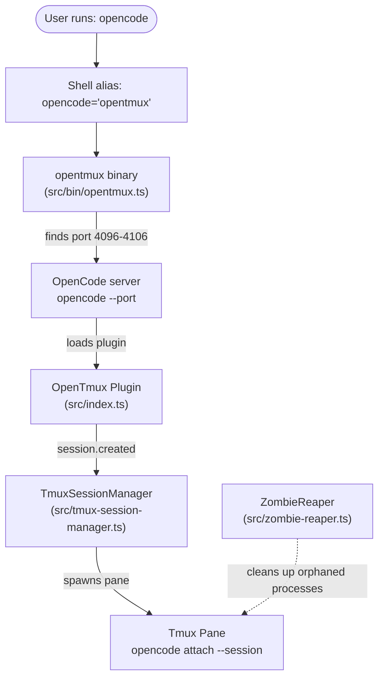
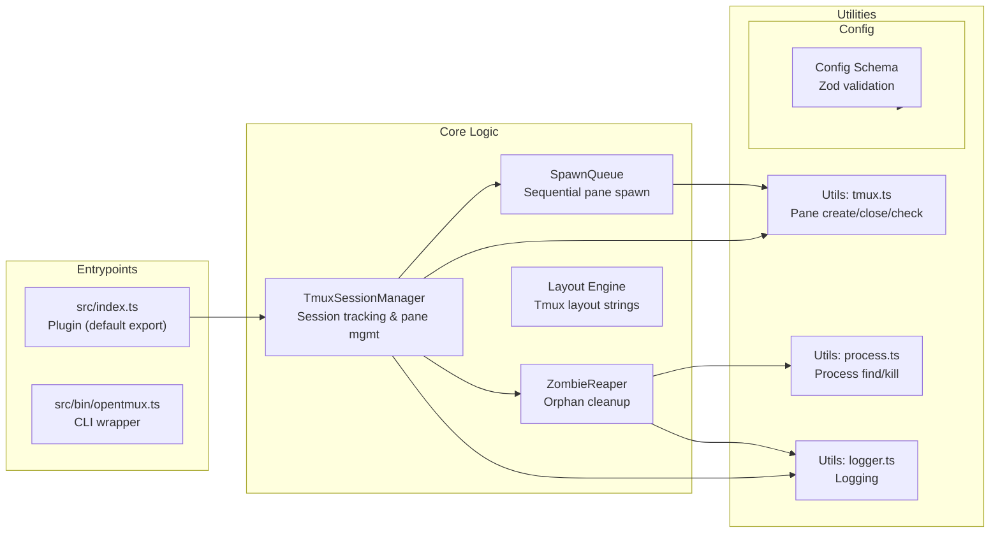
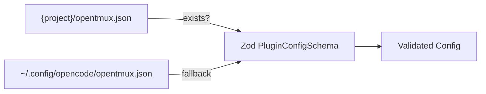
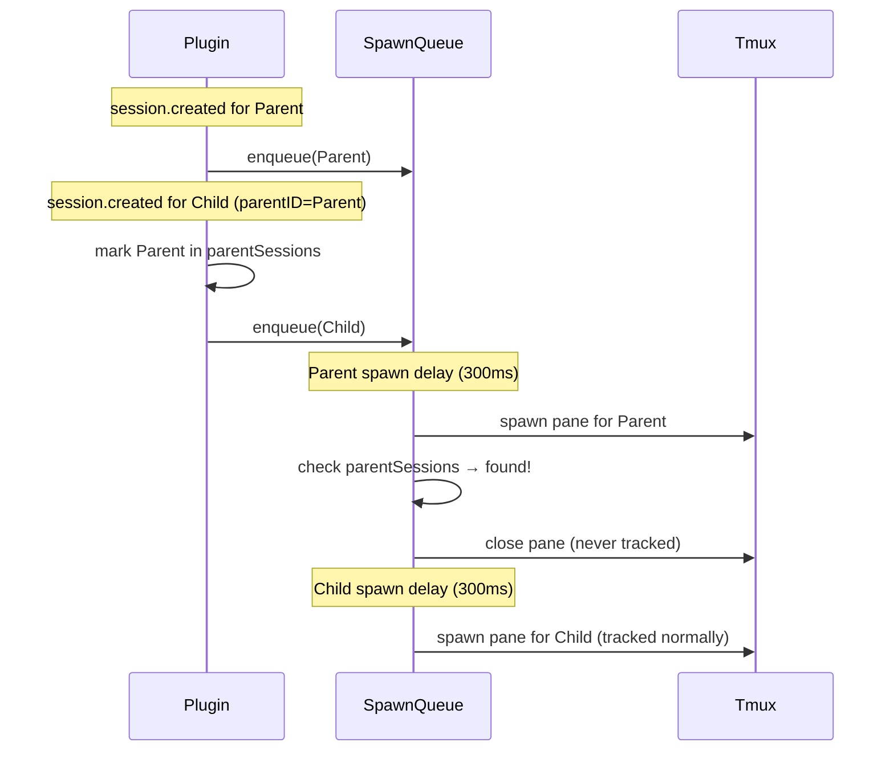
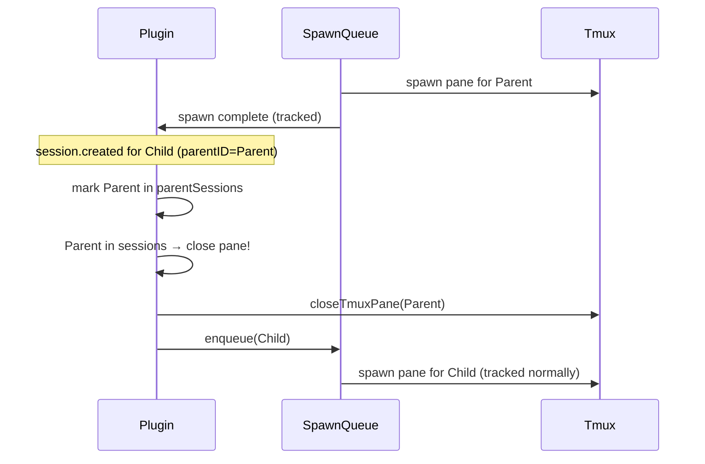

# Architecture

## Overview

OpenTmux is an OpenCode plugin with two entrypoints:

1. **Plugin** (`src/index.ts`) — loaded by OpenCode at runtime via the plugin system
2. **Binary wrapper** (`src/bin/opentmux.ts`) — a smart CLI that replaces the `opencode` command



## Session Management Flow

```
User runs: opencode
  → Shell alias: opencode='opentmux'
    → opentmux finds available port (4096–4106)
    → spawns: opencode --port <port>
      → OpenCode loads the plugin
        → plugin receives session.created events
          → TmuxSessionManager spawns tmux panes
            → polls session status
              → closes panes when sessions end
```

## Component Architecture



### TmuxSessionManager (`src/tmux-session-manager.ts`)

The central orchestrator that ties session lifecycle to tmux pane management.

**Responsibilities:**

- Subscribes to OpenCode's `session.created` event
- Detects child sessions (subagents) by checking for `parentID`
- Spawns tmux panes for each agent via the `SpawnQueue`
- Polls session status periodically and closes panes when sessions complete

**State Fields:**

| Field | Type | Purpose |
|-------|------|---------|
| `sessions` | `Map<string, TrackedSession>` | Sessions with active panes |
| `pendingSessions` | `Set<string>` | Sessions awaiting pane spawn |
| `parentSessions` | `Set<string>` | Sessions identified as parents (have children) — their panes get discarded |

### SpawnQueue (`src/spawn-queue.ts`)

A sequential queue that ensures panes are created one at a time with a configurable delay between spawns.

**Key Characteristics:**

- **Sequential processing** — items are dequeued and processed one at a time
- **Coalescing** — duplicate session IDs queued multiple times are processed only once
- **Exponential backoff retry** — failed spawns retry with increasing delay (base: 250ms)
- **Stale threshold** — items older than 30s are skipped
- **Drain callback** — `onQueueDrained` triggers a tmux layout refresh when the queue empties

### ZombieReaper (`src/zombie-reaper.ts`)

A background process that cleans up orphaned `opencode attach` processes.

**Key Characteristics:**

- Periodically scans for `opencode attach` processes whose parent sessions have ended
- Tracks zombie candidates with a detection count and `firstDetectedAt` timestamp
- Kills only after `minZombieChecks` and `gracePeriodMs` to avoid false positives
- Verifies session status against the OpenCode server before killing
- `autoSelfDestruct` stops the reaper after `selfDestructTimeoutMs` (1h default) when the server is abandoned

### Binary Wrapper (`src/bin/opentmux.ts`)

A smart CLI that replaces the `opencode` command via shell alias.

**Responsibilities:**

- Finds an available port in the range 4096–4106
- Optionally reclaims stuck ports by killing orphaned `opencode` processes
- Spawns `opencode --port <port>` with the selected port
- If not already inside tmux, creates a new tmux session
- Supports `--reap` flag for manual zombie reaping
- Port rotation via `rotate_port` config option

### Plugin Entry Point (`src/index.ts`)

The default export that OpenCode loads at startup.

**Flow:**

1. Shared `isInitialized` boolean prevents double initialization
2. Config is loaded via `loadConfig(ctx.directory)` — validates against Zod schema
3. Server URL is detected from `OPENCODE_PORT` env var or defaults to 4096
4. A `TmuxSessionManager` instance is created with the config
5. Returns hooks with `name: 'opentmux'` and an `event` handler that delegates to `TmuxSessionManager.onSessionCreated()`
6. Re-exports types: `PluginConfig`, `TmuxConfig`, `TmuxLayout`

### Config Schema (`src/config.ts`)

Zod-validated configuration loaded from two locations (local takes precedence):



**Key defaults:**

```json
{
  "enabled": true,
  "port": 4096,
  "layout": "main-vertical",
  "main_pane_size": 60,
  "auto_close": true,
  "spawn_delay_ms": 300,
  "max_retry_attempts": 2,
  "layout_debounce_ms": 150,
  "max_agents_per_column": 3,
  "rotate_port": false,
  "max_ports": 10
}
```

## Session Event Hierarchy

When an agent uses `task`/`delegate` tools to spawn subagents, OpenCode creates a tree of sessions:

```
Root Session (no parentID → filtered out, no pane)
  └─ Tool-call Wrapper Session (parentID=root)
       └─ Actual Subagent Session (parentID=wrapper)
```

Each session fires a `session.created` event. The plugin's `onSessionCreated` handler in `TmuxSessionManager` processes these events.

## Parent-Session Dedup (v1.5.8+)

### Problem

Tool-call wrapper sessions are intermediate/transient — they exist only to bootstrap a subagent and have no meaningful output. However, they fire `session.created` like any other session, causing the plugin to create an unwanted tmux pane for each one.

For a swarm of 2 subagents:

- Without fix: 5 panes (main + wrapper1 + agent1 + wrapper2 + agent2)
- With fix: 3 panes (main + agent1 + agent2)

### Solution

A `parentSessions: Set<string>` field tracks which session IDs have been referenced as a `parentID`. Two detection paths ensure no intermediate session keeps a pane:

**Path A — Child arrives before parent's spawn completes (common):**
The `SpawnQueue` processes items sequentially with `spawn_delay_ms` (default 300ms) between items. Children typically arrive during this delay. When the parent's spawn completes, a check against `parentSessions` catches it, and the pane is closed immediately without tracking. No visual flicker — the intermediate pane never appears.



**Path B — Child arrives after parent already has a pane (edge case):**
When a child event arrives, its `parentID` is looked up in `this.sessions`. If found, the parent's pane is closed and removed from tracking.



### Edge Cases Handled

| Scenario | Behavior |
|----------|----------|
| Multiple children of same parent | Parent's pane closed once; children both tracked |
| Deep nesting (A→B→C) | Each intermediate session's pane closed |
| Rapid burst of children (5+) | Parent pane closed once, all children tracked |
| Triple concurrency (GP/P/C in-flight) | Intermediate panes discarded, only leaf child tracked |
| Parent spawn fails → child arrives | No stale pane to close; child spawns normally |
| Leaf sessions (no children) | Unaffected — pane tracked normally |
| Unrelated sessions (different parents) | Both tracked independently |
| Spawn failure for intermediate session | Graceful — no pane to close |

### Interaction with Existing Systems

- **`closeTmuxPane`** internally calls `applyTmuxLayout`, so closing a parent's pane automatically triggers a layout refresh — no additional management needed.
- **`SpawnQueue`** coalesces duplicate session IDs, preventing race conditions.
- **`pendingSessions`** Set and **`sessions`** Map remain the primary dedup layers; `parentSessions` is additive.

## Log Files

| Component | Path |
|-----------|------|
| Plugin runtime | `/tmp/opencode-agent-tmux.log` |
| Binary wrapper | `/tmp/opentmux.log` |

Both are append-only and silently swallow errors if writes fail.
